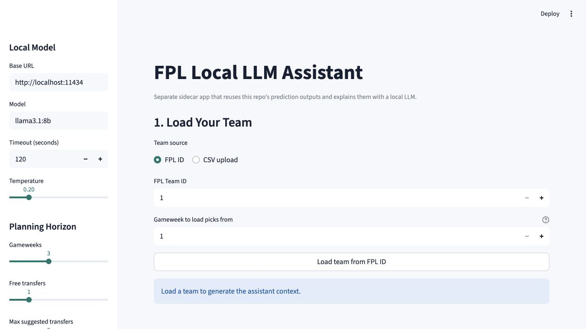

# Local LLM FPL Assistant

This is a separate Streamlit app that explains the repository's deterministic
FPL analysis with a model running through a local Ollama-compatible chat API.
It does not replace the prediction pipeline, run the AI Manager simulation, or
submit changes to the official FPL website.



## What It Does

- Loads the official next-Gameweek prediction file and up to six consecutive
  `outputs/predictions_gw<N>.csv` files.
- Accepts a complete 15-player squad from an FPL ID or CSV upload.
- Reuses the repository's deterministic lineup, captaincy, squad comparison,
  confidence/risk, multi-Gameweek target, and transfer calculations.
- Sends a structured analysis—not the entire repository—to a local chat model
  for a conversational explanation.
- Can optionally search DuckDuckGo Lite for current injury, suspension,
  availability, rotation, and press-conference snippets.

The expected-points and transfer numbers come from this repository's generated
artifacts. The model explains those numbers; it does not invent or recalculate
them. Online result text is labeled untrusted in the prompt and should be
verified at the linked source before acting.

## Prerequisites

Install this repository first from its root directory:

```bash
python -m venv .venv
source .venv/bin/activate  # Windows: .venv\Scripts\activate
python -m pip install -r requirements.txt
```

Install [Ollama](https://docs.ollama.com/quickstart), then download a model. The
app defaults to `llama3.1:8b`:

```bash
ollama pull llama3.1:8b
ollama list
```

`llama3.1:8b` is about 4.9 GB in Ollama. Other local chat-capable examples are
`mistral:7b` and `qwen2.5:7b-instruct`; enter the exact installed tag in the
app's **Model** field. Choose a model that fits your machine's memory.

The default base URL is `http://localhost:11434`, and the app calls
`POST /api/chat`. The Ollama desktop app normally manages the service. If your
installation does not, start it in a separate terminal:

```bash
ollama serve
```

## Generate Prediction Inputs

Run the prediction pipeline before launching the assistant:

```bash
python main.py --force-refetch
```

For a longer assistant horizon, use the main dashboard's **Build predictions
through** update control or generate a range from the command line:

```bash
python main.py --replay-start-gw 1 --replay-end-gw 6
```

Replace `1` and `6` with the official next Gameweek and inclusive target. The
assistant currently reads the latest root `outputs/predictions_gw<N>.csv`
files, not the AI Manager's archived season directories. Missing Gameweeks in
the selected horizon are reported in the analysis.

## Run The Assistant

From the repository root, with the Python environment active:

```bash
python -m streamlit run local_llm_fpl_assistant/app.py
```

Then:

1. Confirm the **Base URL** and an installed **Model** tag.
2. Select a one-to-six-Gameweek planning horizon, free transfers, and the
   maximum number of suggested transfers.
3. Decide whether **Search web when useful** should be enabled. A manual query
   forces a lookup for each question until that field is cleared.
4. Load a full squad by FPL ID or CSV.
5. Review the deterministic metrics, transfer preview, risk flags, and lineup.
6. Ask questions such as:
   - “Who should I captain and why?”
   - “What transfer improves my team most over this horizon?”
   - “Which low-confidence players should I monitor?”
   - “Is there current injury news for this player?”

Changing the team reloads the analysis and clears the current chat history.

## Team Inputs

### FPL ID

Find the numeric ID in an official FPL URL such as `/entry/<id>/`. The assistant
loads that entry's picks for the last completed Gameweek. Before GW1, or when an
entry has no completed picks yet, use CSV upload instead.

### CSV

The file must contain exactly 15 unique players and include:

- `player_id`

Optional columns are:

- `starting`
- `bench`
- `captain`
- `full_name`

If lineup columns are absent, the app creates a default split where possible
and enriches all players from the prediction and cached bootstrap data.

Example:

```csv
player_id,starting,bench,captain
1,1,0,0
25,1,0,1
47,0,1,0
```

The example is intentionally incomplete; a real upload must contain all 15
players.

## Online Lookup And Privacy

Online lookup is enabled by default but only runs automatically for
freshness-sensitive question wording, such as injuries, availability,
suspensions, rotation, or latest news. The search sends a generated query to
DuckDuckGo and passes result titles, snippets, domains, and URLs to the local
model. Disable it if you want the explanation to remain fully local.

Loading by FPL ID sends the ID and Gameweek to the public FPL picks endpoint.
CSV input avoids that request. Ollama prompts remain on the configured model
endpoint; a non-local base URL is outside this app's local-only assumption.

## Troubleshooting

- **No prediction files found**: run the main pipeline or the dashboard update
  first and confirm `outputs/predictions_gw<N>.csv` exists.
- **Missing future Gameweeks**: rebuild through the desired target, then reload
  the assistant.
- **Failed to reach the local LLM endpoint**: confirm Ollama is running, the
  base URL is `http://localhost:11434`, and `ollama list` shows the selected tag.
- **Model not found**: pull the exact tag or change the app's **Model** field.
- **FPL ID error**: confirm the ID and use CSV before a completed Gameweek has
  published picks.
- **Online lookup failed**: the deterministic analysis still works; retry,
  disable lookup, or verify news directly at an authoritative source.
- **Slow responses or timeouts**: choose a smaller model or increase the
  sidebar timeout.

Official references: [Ollama quickstart](https://docs.ollama.com/quickstart),
[Ollama chat API](https://docs.ollama.com/api/chat), and
[Ollama model library](https://ollama.com/library).
